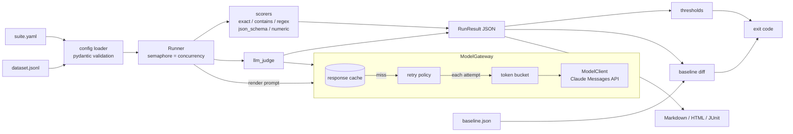

# llm-eval-kit

[](https://github.com/rahulkumar96t/llm-eval-kit/actions/workflows/ci.yml)

`llm-eval` is a small command-line tool for regression testing LLM features. You describe
test cases in a YAML suite and a JSONL dataset, it runs them against Claude (or scores
outputs you already recorded), grades each output with deterministic scorers and an
optional LLM judge, compares the run with a stored baseline, and writes Markdown, HTML and
JUnit reports. Threshold and regression results map to exit codes, so a pull request that
makes the prompt worse fails CI the same way a broken unit test does.

## Features

- **Suites as data**: YAML suite + JSONL dataset; `{field}` placeholders in prompts are
  filled from each row; scorers can be set for the whole suite or per case.
- **Scorers**: `exact`, `contains` (all / any / none), `regex`, `json_schema` (JSON Schema
  2020-12 via `jsonschema`), `numeric` (absolute / relative tolerance), and `llm_judge`
  (Claude grades against a rubric and returns a structured 1-5 verdict).
- **Async runner** with bounded concurrency, a token-bucket rate limit (requests per
  minute) and retries with exponential backoff and jitter that honour `Retry-After`.
- **On-disk response cache** keyed by a SHA-256 of prompt + model + every request
  parameter, so re-running an unchanged suite costs nothing and reports are reproducible.
- **Baseline diff**: regressions (passed to failed, or a score drop beyond a tolerance),
  improvements, new and removed cases.
- **Reports**: Markdown (good for PR comments), a self-contained HTML file (inline CSS, no
  scripts, all model output escaped) and JUnit XML for CI test viewers.
- **Exit codes** for thresholds and regressions; config mistakes are caught before any
  model call (`llm-eval validate`).
- **Recorded mode**: `provider: recorded` scores outputs already in the dataset, for
  gating on logged production responses or trying the tool without an API key.

## Architecture



The runner depends only on a `ModelClient` protocol (`complete(ModelRequest) ->
ModelResponse`). The Claude implementation lives in `models.py`; the tests use a scripted
fake. Judges go through the same gateway as the model under test, so they share the cache,
the rate limit and the retry policy.

| Module | Responsibility |
| --- | --- |
| `config.py` | Suite and dataset parsing, template rendering, config errors |
| `models.py` | `ModelClient` protocol, Claude client, retryable-error classification |
| `ratelimit.py` | Token bucket and retry policy |
| `cache.py` | Cache key and atomic on-disk store |
| `scorers.py` | The six scorers and their option validation |
| `runner.py` | Gateway (cache, limit, retry) and the concurrent case runner |
| `results.py`, `thresholds.py`, `baseline.py` | Run model, summaries, checks, diffs |
| `reports.py` | Markdown, HTML and JUnit writers |
| `cli.py` | `llm-eval run / diff / validate` and exit codes |

## Quickstart

Requires Python 3.11+ and [uv](https://docs.astral.sh/uv/). The package is not on PyPI;
install it from source:

```bash
git clone https://github.com/rahulkumar96t/llm-eval-kit.git
cd llm-eval-kit
uv sync

# Offline: score recorded outputs (no API key needed)
uv run llm-eval run examples/recorded/suite.yaml --report-html report.html

# Live: call Claude for every case (credentials are read from the environment only)
export ANTHROPIC_API_KEY=...
uv run llm-eval run examples/qa/suite.yaml --save-baseline baseline.json
uv run llm-eval run examples/qa/suite.yaml --baseline baseline.json \
    --report-md report.md --junit junit.xml
```

To use it from another project: `uv tool install git+https://github.com/rahulkumar96t/llm-eval-kit`.

## Usage

### A suite

```yaml
name: support-assistant-qa
dataset: qa.jsonl                  # relative to this file
provider: anthropic                # or "recorded"
# model: claude-sonnet-5-5         # default; LLM_EVAL_MODEL or --model override it
system: |
  You are the support assistant for a small online bookshop. ...
prompt: "{question}"               # {field} comes from each JSONL row; {{ }} for braces
params:
  max_tokens: 2048
  effort: low                      # low | medium | high | xhigh | max | none (omit)
scorers:                           # applied to every case
  - type: llm_judge
    name: judge
    rubric: |
      The answer must be consistent with this reference: "{reference}".
    pass_score: 4                  # 1-5; normalised score is (grade - 1) / 4
thresholds:
  pass_rate: 0.8                   # share of cases where every scorer passed
  scorers:
    judge: {mean_score: 0.75}      # per-scorer pass_rate and/or mean_score
  max_regressions: 0               # allowed regressions vs --baseline
  score_tolerance: 0.25            # score drop that still counts as unchanged
```

Each dataset line is a JSON object. `id` is optional (defaults to `case-0001`, ...), every
other field is available to templates, and an optional `scorers` list adds case-specific
scorers:

```json
{"id": "return-window", "question": "How many days do I have to return a book?", "reference": "Within 30 days of delivery.", "scorers": [{"type": "numeric", "expected": 30}]}
```

`temperature`, `top_p` and `top_k` are rejected at load time: Claude API version
2026-10-21 (sent by `anthropic` 2.x) returns 400 for them on every model.

### Scorers

| Type | Options | Passes when |
| --- | --- | --- |
| `exact` | `expected` or `expected_field`, `ignore_case`, `strip` (default true), `collapse_whitespace` | normalised output equals the expected value |
| `contains` | `values` or `values_field` (string or list), `mode` (`all`/`any`/`none`), `ignore_case` | all / any / none of the values occur; score is the fraction satisfied |
| `regex` | `pattern` or `pattern_field`, `flags` (`i`, `m`, `s`, `x`), `fullmatch`, `negate` | the pattern is found (or not, with `negate`) |
| `json_schema` | `schema` (inline) or `schema_file` | output parses as JSON (a Markdown code fence is tolerated) and validates |
| `numeric` | `expected` or `expected_field`, `abs_tol`, `rel_tol`, `pick` (`last`/`first`/`only`) | the picked number in the output is within tolerance |
| `llm_judge` | `rubric` (required, `{field}` placeholders allowed), `pass_score`, `model`, `effort`, `max_tokens`, `include_input` | the judge's 1-5 grade is at least `pass_score` |

Unknown options are an error, so a typo such as `ignorecase` fails loudly instead of being
ignored. Every scorer gets a `name` (defaults to its type) that thresholds refer to.

### Commands

```text
llm-eval run SUITE [--model M] [--concurrency N] [--rpm N] [--max-attempts N]
                   [--cache-dir DIR | --no-cache] [--output run.json]
                   [--baseline FILE [--allow-missing-baseline]] [--save-baseline FILE]
                   [--tolerance X] [--report-md F] [--report-html F] [--junit F] [-q]
llm-eval diff BASELINE.json CURRENT.json [--tolerance X] [--max-regressions N]
llm-eval validate SUITE        # parse, render every prompt, build every scorer; no calls
```

### Exit codes

| Code | Meaning |
| --- | --- |
| 0 | all thresholds met, no regressions beyond `max_regressions` |
| 1 | a threshold failed |
| 2 | regressions against the baseline |
| 3 | both (codes 1 and 2 are bit flags) |
| 4 | configuration or usage error (bad YAML, missing field, unknown option, bad flag) |
| 5 | every case errored (usually credentials or an unknown model id) |

### Environment variables

| Variable | Default | Purpose |
| --- | --- | --- |
| `ANTHROPIC_API_KEY` | - | Claude credentials (read by the SDK; never passed on the command line) |
| `LLM_EVAL_MODEL` | `claude-sonnet-5-5` | model under test when the suite and `--model` do not set one |
| `LLM_EVAL_JUDGE_MODEL` | the model above | judge model when a scorer does not set `model` |
| `LLM_EVAL_JUDGE_EFFORT` | `low` | judge effort; `none` omits it for models without effort support |
| `LLM_EVAL_FALLBACKS` | on | server-side refusal fallback; set to `off` to disable |
| `LLM_EVAL_CACHE_DIR` | `.llm-eval-cache` | cache location |

**Refusal fallback is on by default.** Requests go to the beta Messages endpoint with
`fallbacks: "default"` (header `server-side-fallback-2026-07-01`), so a request declined by
a safety classifier can be re-run server-side on Anthropic's recommended fallback model.
This is a Claude API feature; set `LLM_EVAL_FALLBACKS=off` for platforms or models that do
not support it. A response that still ends with `stop_reason: "refusal"` is recorded as an
error case (and is never cached), not scored as an empty answer.

### GitHub Actions

A workflow for a repository that keeps its suites in `evals/` and a committed baseline:

```yaml
name: llm-evals
on: [pull_request]
jobs:
  evals:
    runs-on: ubuntu-latest
    steps:
      - uses: actions/checkout@v4
      - uses: astral-sh/setup-uv@v6
      - run: uv tool install git+https://github.com/rahulkumar96t/llm-eval-kit
      - uses: actions/cache@v4
        with:
          path: .llm-eval-cache
          key: llm-eval-${{ hashFiles('evals/**') }}
          restore-keys: llm-eval-
      - name: Run suite
        env:
          ANTHROPIC_API_KEY: ${{ secrets.ANTHROPIC_API_KEY }}
        run: |
          llm-eval run evals/support.yaml --rpm 50 \
            --baseline evals/baseline.json \
            --junit reports/junit.xml --report-html reports/eval.html \
            --report-md reports/eval.md
      - if: always()
        uses: actions/upload-artifact@v4
        with:
          name: eval-reports
          path: reports/
```

To accept a new baseline, run the suite with `--save-baseline evals/baseline.json` and
commit the file with the prompt change.

## Design decisions and trade-offs

- **argparse, not click or typer.** The CLI has three subcommands; the standard library is
  enough and keeps the dependency list to `anthropic`, `pydantic`, `pyyaml` and
  `jsonschema`. argparse exits with 2 on usage errors, which would collide with the
  "regression" code, so the parser is subclassed to exit with 4.
- **The runner owns retries.** The SDK client is created with `max_retries=0` and the
  runner's `RetryPolicy` decides: it retries rate limits, 5xx/overloaded responses,
  connection errors and timeouts, never 4xx request errors. Each attempt takes a token
  from the rate limiter, and attempts are recorded per case.
- **Cache key = everything that shapes the response.** Model, prompt, system prompt,
  max tokens, effort, output schema, stop sequences, provider and the fallback flag are
  hashed as canonical JSON. Refusals and errors are not cached. There is no TTL: delete the
  directory or pass `--no-cache` to force fresh calls.
- **No sampling controls.** Current Claude API versions reject `temperature` and friends, so
  outputs vary between runs. The tool leans on thresholds, score tolerances and the cache
  (for reproducible reports) rather than pretending runs are deterministic.
- **Judge design.** Structured outputs (`output_config.format` with a JSON schema) force the
  verdict shape; the schema puts `reasoning` before `score`. The judge prompt marks the
  input and response as data, and wraps them in tags whose names include a hash of the
  content, so an output cannot close its own tag and inject grading instructions. A judge
  refusal or an unparseable verdict is a failed score with the reason in the report.
- **Status beats score in the baseline diff.** A case that stops passing is a regression
  even if its scores barely moved; a case that still passes regresses only if a scorer's
  score drops by more than the tolerance.
- **Config errors before spend.** Every prompt is rendered and every scorer is built (regex
  compiled, JSON schema checked) before the first request.

## Testing

```bash
uv run ruff check . && uv run ruff format --check . && uv run pytest -q
```

The tests run offline with a scripted `FakeModelClient` and a virtual clock. They cover
each scorer (including judge refusals, unparseable verdicts and delimiter forgery), config
validation, cache keys and cache hits, the token bucket, retry classification against real
`anthropic` exception types, the Claude request shape (no sampling params, effort and
output format, fallback on/off), concurrency limits, baseline diffs, all three report
formats (the JUnit file is parsed with `xml.etree`) and every CLI exit code. CI runs them
on Python 3.11 and 3.13.

`tests/test_live.py` makes one real request and is skipped unless both
`ANTHROPIC_API_KEY` and `RUN_LIVE_TESTS=1` are set.

## Limitations and roadmap

- One provider is implemented (Claude). Other providers fit behind the `ModelClient`
  protocol but are not included.
- Single-turn prompts only; no multi-turn conversations, tool use or streaming.
- One judge call per case and scorer. There is no judge calibration, self-consistency
  voting or agreement statistics; spot-check judge verdicts before trusting them.
- No repeated sampling per case, so flaky cases show up as baseline noise. A `repeat: N`
  option with a pass-ratio threshold is the next planned feature.
- The rate limit counts requests, not tokens.
- The cache never expires and is not shared between machines (except through CI caches).

## License

MIT, see [LICENSE](LICENSE).
